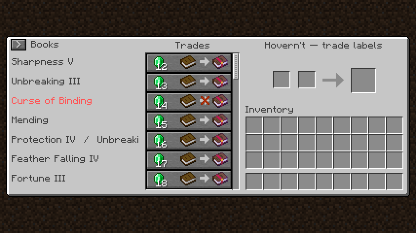
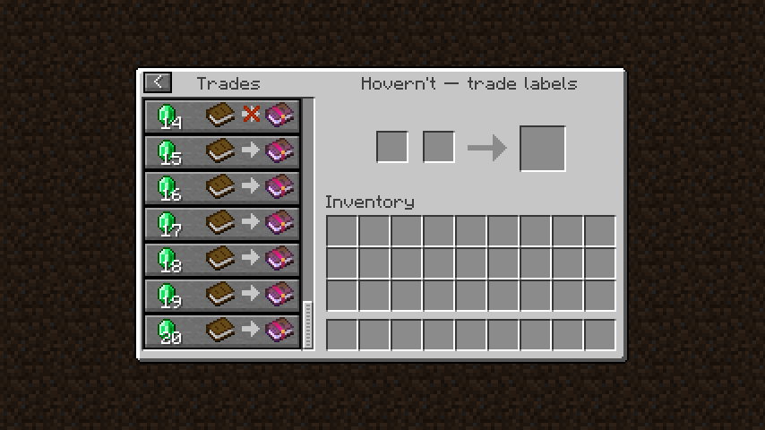

# Hovern't

Read enchantment names directly in the villager trade screen. No hovering required. Your cursor has other places to be.

Hovern't displays each book's translated enchantment names and levels beside its trade. It reads the enchantments on the actual item, so registered modded enchantments work automatically without a whitelist or per-mod setup.

- Multiple enchantments appear together, with scrolling text for long names.
- Curses and custom enchantment colors keep their formatting.
- **>** collapses the sidebar; **<** expands it to the left.
- The connected interface stays centered and keeps your trade-list scroll position.
- Native merchant textures, buttons, and fonts follow your resource pack.

| Minecraft | Fabric | NeoForge |
| --- | --- | --- |
| **1.20.1** | Supported | Supported, legacy 47.1.106 |
| **1.20.2–1.20.6** | Supported in 1.2.0 | Supported in 1.2.0 |
| **1.21–1.21.11** | Supported in 1.2.0 | Supported in 1.2.0 |
| **26.1, 26.1.1, 26.1.2, 26.2, 26.3** | Supported in 1.2.0 | Supported in 1.2.0 |

1.20.1 remains the primary target. Hovern't 1.2.0 supports all 23 stable Minecraft versions from 1.20.1 through 26.3, with a separate JAR for each loader and game version. See [version verification](https://github.com/TAS-69/Hovern-t/wiki/Version-Compatibility) for the exact tested loaders and checks.

Download [Hovern't 1.2.0](https://github.com/TAS-69/Hovern-t/releases/tag/v1.2.0), or use the [download guide](https://github.com/TAS-69/Hovern-t/wiki/Downloads) to find the JAR for your game version and loader. All 46 packages include SHA-256 checksums. Earlier 1.0.0 and 1.1.0 releases remain available for Minecraft 1.20.1.

Install the JAR matching your Minecraft version and loader on the **client**. The server does not need Hovern't. The Fabric build includes its resource-loading dependencies.

The [wiki](https://github.com/TAS-69/Hovern-t/wiki) contains [installation and troubleshooting](https://github.com/TAS-69/Hovern-t/wiki/Installation), [resource-pack support](https://github.com/TAS-69/Hovern-t/wiki/Resource-Packs), [enchantment-mod verification](https://github.com/TAS-69/Hovern-t/wiki/Compatibility-Verification), [version verification](https://github.com/TAS-69/Hovern-t/wiki/Version-Compatibility), and [building and testing](https://github.com/TAS-69/Hovern-t/wiki/Development).

[MIT licensed](LICENSE). Embedded Fabric modules retain their own licenses.
